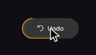
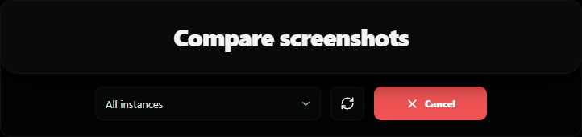
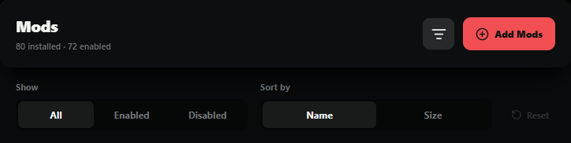

# Delight Client Approved Design Patterns

## Bunny Ears shape and palette — November 26, 2026

Parks approved the Bunny Ears shape after seeing it in Locker and chose white exterior felt and rose pink inner felt for both ears. The stepped silhouettes and slight bend remain visible with the default palette. Each of the four regions remains independently customizable. The approval covers this cosmetic's shape and stock colors.

## November 25, 2026 — Updates settings

Parks approved the revised Updates page on November 25, 2026, calling it “INFINITLY BETTER.” Use this page as the reference for grouping each settings action with its status and for left-aligned, actionable instance results.

## November 25, 2026 — Notification Center feed

Parks approved the compact history and the mark-read action beside the bell, with a correction to left-align title and detail text next to the type icon. Preserve the compact timestamp, fine separators and small unread dot in that feed.

## Cosmetic unlock celebration — November 25, 2026

Parks approved the dedicated after-redemption face with the cape artwork and Equip opening the matching item in Locker. He asked for confetti that falls from the island and fades cleanly. The local animation and final spacing await hands-on review.

## Inline launcher update transition — November 25, 2026

Parks approved the transition from **Update available** and inline confirmation into the launch-style progress bar on November 25, 2026. The confirmation and progress use the same centered title-bar row.

## Notification Center and launch pill — November 25, 2026

Parks approved the implemented top-bar bell, compact dropdown, left-expanding fill, fixed percentage, brief **Launched** state and return to the bell. Approved November 25, 2026. He then requested the same fixed anchor for **Update available**, with the text sliding in and the bell swapping to a download arrow. This earlier updater direction preceded the centered inline launcher update.

For the centered island, Parks requested a different geometry. The entire pill grows equally on both sides of the window center. The launch face showed only a track and percentage, with an earlier attached hover extension for **Cancel launch**. Parks subsequently requested that it grow horizontally inside the title bar to fade in a right-side X that turns red on hover. Parks approved the horizontal launch layout on November 25, 2026. This direction supersedes the earlier left-expanding launch layout. Parks rejected the first centered details layout when it pushed the workspace down. The corrected layout kept the bar at its normal height and eased the outlined detail surfaces downward over the workspace. Parks approved that expanded island on November 25, 2026. Its outline enclosed the compact control and remained visible above the bell’s hover and pressed highlights. His later dark pill direction supersedes that perimeter treatment. The stationary workspace rule continues to apply. Parks later requested horizontal-only confirmation and progress for launcher updates.

## Action button treatment — November 25, 2026

Parks asked for **Updating…** on the Mods action as the sole routine progress state. The action now lives behind the instance header’s three-dot menu. The approval applies to the progress treatment. He rejected the separate progress line and standalone dependency action. Verified dependency work flows through **Update all**.

Parks explicitly rejected black-gradient button faces across the whole client, with the two Settings update checks as examples. The current rule is a flat neutral face for secondary actions and colored ceramic for actions such as **Play**. This supersedes the older dark ceramic button directions below. He requested dependency fixes inside the page. The Mods toolbar placement was superseded on November 25 by the direct update action in the instance overflow and the orange issues trigger beside **Add mods**. The new renders await his visual review.

## Draft author layout — November 25, 2026

Parks approved the original large avatar beside the draft title and **By [name]** line after comparing the inline layout. Use the 34 px leading avatar in both the draft row and open review.

## Shared pack preview — November 24, 2026

In the Meadow player-link preview, Parks was happy to keep the instance identity, release facts, creator’s note and installed-file row styling. He requested changes to file navigation, progress placement and the explanatory sentence. The revised interactions await his hands-on review.

## Pack Workspace Overview direction — November 24, 2026

Parks preferred the revised Delight instance layout with its identity header, stable header action and flat tabs. For installed files he explicitly asked to use the ordinary instance row component. He requested plain, count-free section names and subsequently specified Name and Status columns and a ceramic enabled dot. Those last details await visual review. [Current reference gallery](design-references/current-client/index.html)

Parks explicitly chose the existing ceramic workspace action and header placement as the reference for **Create link** on Access. He approved the revised Access dropdown with centered plain labels and the standard chevron.

## Pack Workspace instance switcher — November 24, 2026

Parks approved the inset dropdown after trying it. Each edge sits halfway between the trigger and the wide sidebar edge. The menu overlays the workspace tabs, and a row highlight identifies the selection without a checkmark. Approval covers this switcher.

Parks approved the overall wallpaper and frosted-sidebar treatment on November 22, 2026. He requested a separate correction to the wing hover and the junction of the rail and title strip.

## Account menu and ceramic controls — requested November 18, 2026

Parks rejected the enclosing account-menu outline and requested a distinct borderless menu. The revision uses an opaque shaded panel, diffuse shadow, readable action rows and an inset dark ceramic Log out control, preserving the approved moving-dock/stationary-drawer interaction and current Undo countdown. This new composition has not yet received visual approval.

He referenced Home Play for red ceramic Settings danger actions, then expanded the request to every accent action, account add, on-state toggles, neutral Cache/Change buttons and photo actions. This is authorization to apply the finish, not visual approval of the result. He subsequently rejected the strong bright rim on small options buttons and requested darker, duller material, softer directional corner shading and a modest hover increase that stays below the rejected brightness. His follow-up rejects lighting visible around the whole perimeter: keep it to the upper-left edge and fade hover brightness in and out. Preserve existing accent/red semantics and navigation styling. The shared softer rendering awaits review.

## Account-menu Log out — Undo countdown, November 18, 2026

Parks requested the supplied Archive-to-Undo interaction for the account-menu Log out button: the same control changes to Undo while a ring retreats around its perimeter, then signs out if not undone. Keep Log out’s icon/label alignment and font family; inset the footer within the borderless account menu and round the upper corners to the existing 13px lower-corner radius. Following Parks’s correction, use a dark neutral gray surface instead of a red fill, a stronger label and icon, and a red countdown stroke instead of orange. Parks subsequently requested ceramic for Log out, superseding its earlier matte-only exclusion. Reuse the account dock’s 160-degree shading and soft inset bevels with an even darker, near-black neutral face and a soft shadow cast upward from the rounded top onto the rest of the dropdown. Remove the straight divider behind that top edge. Keep hover neutral and adapt the neutral surface and text to Light theme. Use fixed button dimensions, the shared icon/text transition, and a five-second Undo window. The perimeter stroke communicates remaining time; it is an explicitly requested functional countdown, not the decorative selection outline prohibited for navigation.

Do not call the native sign-out action until the deadline. Undo, closing the drawer, account changes, a hidden document and unmount cancel the pending request. Disable the control while the native request completes, reject duplicate native requests, and retain existing account refresh/error handling. Reduced motion, animations off and Ultra preserve the five-second window with discrete progress rather than decorative motion. Keep the account identity dock and neighboring menu actions unchanged.

The supplied image is an interaction reference; the new implementation has not yet been visually approved.

## Portal server list — revised November 17, 2026

Parks rejected the original Portal and then revised the launcher-library direction to a server-list format: “WAY to much information,” “simplify it alot,” and add simple feedback animations like the instance Add Mods button. The card grid and Continue section are superseded. Use compact full-width rows with a small icon, destination name, one secondary line and Join/Play. Keep instance/version details and maintenance actions in the row options. Avoid repeated counts, subtitles, badges and recent-play summaries. Use separate surfaces below the Portal header: a standalone search bar, a view selector and a separate filter control, then individual Servers and Worlds list panels with their headings outside. Leave page background visible between these areas; do not put the entire workspace inside one continuous block. Extra filters reveal their own compact panel. Parks supplied the Locker screenshot as a separation/spacing reference, not approval of this Portal implementation. Parks also requested that servers and worlds be easy to distinguish on All without visual clutter: group that view under two small Servers/Worlds headings, preserving sorting within each group. Hide empty groups and omit redundant headings on the dedicated tabs. Parks explicitly requested Minecraft’s real default server artwork instead of a server-stack illustration for missing server icons; keep custom server icons when present.

Reuse the Add Mods interaction language: a persistent Add/Back action with an icon swap, an attached animated form, confirmed favorite transitions and brief copy/save feedback. On November 18 Parks requested cleaner, more distinctive favorite/filter hover feedback. Keep the star upright, use a faint fill preview for an unsaved favorite, and reserve the solid fill for confirmed selection. The filter icon may adjust its three line lengths in place; button geometry and labels stay fixed. This replaces the earlier tilted-star treatment. Parks approved the resulting favorite/filter hover as “way better, almost perfect” on November 18; that approval covers those hover effects. He then requested the same treatment for All/Servers/Worlds and a more distinctive selected state. Parks rejected the proposed dot and accent-tinted/outlined selected tab: never use dots, underlines, side lines or other decorative markers, or accent-colored fill/border, to indicate the selected view. Use neutral material depth instead, inspired by the sidebar ceramic treatment but distinct from it. Portal’s selected surface uses a restrained neutral gradient and soft inset/lower shading, with fixed label positions and a sliding selection. View-tab hover stays neutral. This replacement awaits visual approval. Respect animation-off, Ultra and reduced-motion settings. Existing discovery, owning-instance launch checks and native persistence remain authoritative. Never invent online status, ping or player counts.

This records the requested direction and rejected proposals. The server-list implementation still awaits visual approval.

## Delight branding — November 17, 2026

Parks requested the Delight name and supplied wing logo for the client and every Bloom-named companion project. Use Delight Client, Delight Cosmetics, Delight Benchmark, Delight Admin, Delight Animation Creator, Delight Books and Delight Servers in visible copy and native product metadata. Preserve existing layouts and theme behavior. This approves the name and source artwork, not a redesigned interface.

Keep account/keyring names, storage paths, mod IDs, Java namespaces, emote format identifiers, live URLs, updater endpoint and signing configuration compatible. See [BRANDING.md](BRANDING.md) for installer and asset details.

## Visual toggle feedback — selected direction, revised November 11, 2026

Parks selected gentle toggle-thumb compression. Keep its state-owned travel, restrained squash and motion preferences. The earlier optional interaction-audio direction was withdrawn on November 11: interface sounds and their settings are removed. That audio experiment is not an approved pattern to reuse.

This is the short list of designs Parks has explicitly approved as especially successful. Each entry distinguishes an approved Bloom implementation from an external quality reference. Reuse the relevant principle, not every detail everywhere.

Read this alongside [DESIGN_RULES.md](DESIGN_RULES.md), which contains the current requirements, and [UI_CHANGE_HISTORY.md](UI_CHANGE_HISTORY.md), which preserves corrections and superseded attempts. A later explicit correction takes precedence over an earlier example.

For approved professional changelog/timeline and dashboard references, see [PROFESSIONAL_INTERFACE_REFERENCE.md](PROFESSIONAL_INTERFACE_REFERENCE.md). Adapt their hierarchy and composition to Bloom's current themes and selected accent.

## Instance controls — selected direction, November 3, 2026

Parks selected inline title renaming, but subsequently requested restoring the original instance appearance. The quieter artwork/name/Play cards and corner action placement are superseded, not approved implementation examples. Preserve the original metadata and Play/Folder/More action row; functional renaming does not authorize changing that layout.

The initially selected permanent bottom Play dock was explicitly rejected. The replacement direction keeps the original header controls and offers an optional draggable floating copy from the menu. It follows its chosen instance across tabs, resizes continuously into a Play icon, and has a Put away action. Reuse the principle of optional, user-positioned controls; do not add permanent floating bars to other pages.

## Single screenshot comparison action

**Explicitly approved:** October 20, 2026. Parks said the page and the Compare/Cancel interaction look great. This approval is specific to screenshot comparison; the subsequently reported Locker bugs still required correction.

The same fixed-width button starts selection, shows `Compare (0/2)` through `Compare (2/2)`, and reveals Cancel on hover or keyboard focus while fewer than two images are selected. At two it opens comparison. Its text/icon transition in place, the gallery owns selection and deselection, and there is no extra bottom tray, prompt or separate cancel button. Initial activation shows the count before a later hover reveals Cancel.

## Connected instance content toolbar

**Explicitly approved:** October 20, 2026. Parks called the completed toolbar “actually perfect” and “beautiful,” then requested that its lessons be retained in the design documentation.

**Current example:** Mods, Resource Packs and Shaders in an opened instance. [Component](src/components/ContentToolbar.tsx), [styles](src/components/content-toolbar.css), [interaction checks](tests/content-toolbar-ui.mjs).

The screenshot records the historical October 20 toolbar with fixture data. Its red accent and example counts are not fixed product requirements.

### What makes it work

- The raised category header and recessed tools feel like parts of one workspace. The attached drawer shown in the screenshot belongs to the original toolbar.
- The boxed `80` badge is replaced by a quiet second line such as `80 installed · 72 enabled`. Searching or filtering changes that line to matching versus total counts; catalog mode identifies the instance's Minecraft version and loader. Every number comes from real current state.
- Motion explains the interaction: the drawer reveals, neutral selection surfaces slide between Show/Sort choices, and the header copy and Add/Back icon transition when entering or leaving the catalog. Filtering and navigation do not wait for animation to finish.
- Add and Back remain the same mounted, focusable action. The workspace changes context without making the user relocate the way back.
- The catalog sidebar shares horizontal space with the list. Compact windows stack the sidebar above results.
- Flat action buttons, restrained borders, existing typography and theme-aware depth give the interaction its character. There are no ornamental counters, glows, fading underlines or thick button rims.

### Reuse this pattern for

- A bounded set of tools belonging to the same content workspace, especially when showing the tools should leave the current results and search accessible.
- A reversible context change where the same header and action can communicate both entry and return.
- A count that becomes more useful when it describes the current view, rather than repeating a title in a badge.

### Do not reuse it for

- Every dropdown, sidebar selection or action button. This approval does not authorize a global navigation or button redesign.
- Long menus or complex forms that need independent scrolling or a dedicated view.
- A third, lighter panel beneath an existing dark control shelf. Parks rejected that adaptation on October 20: extend the existing shelf downward, reduce the gap under its controls and reveal contents within the same surface.
- Oversized empty selection cards or a whole drawer sliding in from the left. Revealed tools emerge in place, with left-to-right timing between multiple elements. Parks's final screenshot correction removes its lower selection area completely: the existing Compare button owns the live `0/2`–`2/2` count, reveals Cancel on hover/focus at zero or one selection, and opens comparison at two. The earlier prompt, thumbnail tray and separate X button are superseded; connected interaction does not require adding a drawer.
- Decorative movement, artificial loading delays or an entrance animation on the existing installed rows. “More involvement” means clear interaction feedback, not movement everywhere.

**Requested reuse, October 20:** Parks asked for the other suitable main toolbars to share this connected feel while keeping normal buttons and the sidebar unchanged. Instances, screenshot comparison and Modpacks adapt the pattern. The earlier full-width Locker category shelf was superseded by the later Shop / Locker request; categories now belong inside the owned collection. The new Shop layout is implementation work awaiting visual review, not an approved reference. The original Mods toolbar and the final single-button comparison interaction are explicitly approved references; do not treat the initial three-surface adaptation or all other adaptations as approved.

### Regression checklist

- **Add Mods, November 26:** Parks approved moving the existing catalog filters into a left sidebar with titled dropdowns and requested direct opening without a Filter button. He rejected the apparent resizing and abrupt list swap. The revised transition uses horizontally sliding, overlapping lists with matching row heights and a crossfade. Parks approved the list slide and requested that the sidebar move and fade with it like a drawer, with shared speed, spacing, and bounded travel. The approved list transition is the reference. The drawer revision awaits visual review. Parks retired the historical installed filter menu from the Mods, Resource Packs and Shaders toolbars. He approved the Add and Back icon spin and asked to animate the width, label fade, subtle scale and red outline. The revised button awaits visual review.
- Catalog dropdowns and Reset update real results and reset pagination. Installed search matches enabled and disabled files.
- Add/Back preserve real catalog compatibility checks, caching, loading, installation and return behavior. A blocked catalog action must not falsely transition the header.
- Escape closes an open catalog dropdown and restores its trigger focus. Back to installed hides the sidebar and keeps focus on the same action.
- Search stays anchored as Add and Back change width. Crossfade the empty search hint and the category or Minecraft readout on mode changes. Page ranges crossfade with short horizontal movement and retain their right alignment. The drawer and lists keep their gap and row alignment throughout travel.
- OLED, Light, custom accents/backgrounds and compact windows retain readable controls. Reduced Motion, Show Animations off and Ultra Performance remove decorative motion without removing functionality.

## Focused choice dialog with consistent cards

**Approved reference:** October 19, 2026. Parks supplied a hosting-plan dialog as a visual reference only; Bloom has no requested plans, billing, hosting, or subscription feature.

- Clear modal silhouette over a subdued backdrop, with a separated header and compact step navigation.
- Equal-width cards use consistent padding, aligned actions, strong titles, and quiet supporting details with small unboxed icons.
- A selected choice receives one coherent tinted surface and restrained border. Adapt to Bloom's active theme and accent rather than copying the reference's multicolor plan buttons or promotional badges.
- A full-width alternative below the main choices separates custom setup from common options without adding another competing card.
- Use these patterns when a real task benefits from comparing a few choices or a short setup flow. Keep copy concise, avoid decorative fading underlines, and do not invent stages, plans, or features solely to reproduce the reference.

**Scope correction:** Parks rejected the three-card New Instance implementation derived from this reference on October 19. The reference remains approved inspiration; that implementation does not. New Instance uses the direct setup form with visible Memory Allocation and Java selection, as recorded in DESIGN_RULES.md.

## Full-bleed artwork with hover-to-change

**Approved:** August 20, 2026  
**Current example:** The instance-page header artwork selector.

### What makes it work

- Artwork fills its entire media square and reaches the parent card's top, bottom, and left clipping edges. There are no inset gaps or a separate frame around the image.
- The artwork and surrounding card use one continuous surface hierarchy. The left side is not turned into an unrelated second-color platform.
- A restrained horizontal shadow falls only toward the content side. It separates the artwork without creating a glow.
- Identity text is explicitly layered above the artwork shadow, preserving crisp readability regardless of the uploaded image.
- The resting state contains no permanent edit badge, corner bubble, or overlapping control.
- Hovering dims the full artwork by a meaningful amount and reveals one centered horizontal-switch icon. The icon fades in while scaling from slightly smaller to full size.
- Leaving reverses the same animation cleanly. Keyboard focus exposes the same affordance.
- Because the artwork is full-bleed, it does not use positional hover or click-pop transforms; moving or shrinking it would expose gaps along the card edge.
- Reduced Motion, Show Animations off, and Ultra Performance Mode remove the transition without removing the affordance.

### Reuse this pattern for

- Cover art, avatars, thumbnails, and other media that is itself the clickable replacement target.
- Cards where a permanent edit icon would cover important artwork or add visual clutter.
- Full-bleed media sitting beside text that benefits from subtle depth separation.

### Do not reuse it for

- Normal action buttons, navigation, dropdowns, or controls whose resting purpose is not visually obvious.
- Destructive replacement flows that require confirmation or explanatory copy.
- Tiny media where dimming would make the target difficult to recognize.

### Regression checklist

- Uploaded image and fallback artwork both fill the same clipping area.
- No gaps appear at rest, on hover, during click, or when focus leaves.
- The shadow never muddies or overlaps the identity text.
- The switch icon is centered on both axes and remains readable on bright and dark artwork.
- Long names and paths remain above the shadow and truncate safely.
- Mouse, keyboard, reduced-motion, disabled-animation, and Ultra Performance states all work.

## Sliding account dock with a stationary masked drawer

**Approved:** August 20, 2026  
**Current example:** The signed-in account control at the bottom of the sidebar.

### What makes it work

- The closed state is one compact account dock with a full-height, full-bleed avatar on the left, one vertically centered account name, and one disclosure chevron.
- It contains no redundant provider/status subtitle, presence ornament, or separate Settings gear.
- Opening translates only the real account dock upward. Downloads and Logs remain completely stationary underneath.
- The action drawer is already fixed at its final coordinates. It never translates or runs a separate slide animation.
- A clip mask reveals and conceals the stationary controls as the account dock moves, making the dock behave like a physical cover.
- While open, the dock becomes the raised identity platform and casts Bloom's restrained curved shadow over the darker recessed drawer.
- The drawer extends 14px behind the dock, filling beneath both rounded lower corners so the sidebar can never show through as black triangular gaps.
- Profile & Accounts and Client Settings remain concise icon rows. Log out is separated and uses restrained red semantics without unnecessary explanatory copy.
- Clicking the dock again, clicking outside, pressing Escape, or choosing Profile/Settings closes the drawer and returns the dock to its exact resting position. Log out now keeps the drawer open for its requested five-second Undo window; the completed native action closes it. Closing the drawer during the window cancels the pending logout.
- The entire interaction respects Show Animations, Reduced Motion, and Ultra Performance Mode.

### Reuse this pattern for

- Bottom-anchored identity or utility drawers where surrounding navigation must not reflow.
- Small fixed action groups that should feel physically revealed rather than spawned as a detached popover.
- Interfaces where one existing card can naturally become the raised header of its expanded state.

### Do not reuse it for

- Long or dynamically sized menus that cannot use a predictable masked region.
- Menus that need to escape a constrained sidebar or remain open while navigating unrelated pages.
- Content whose controls need explanatory copy, independent scrolling, or complex nested navigation.

### Regression checklist

- Only the account dock changes screen position; every revealed control remains stationary.
- Downloads and Logs retain their exact layout coordinates while the drawer overlays them.
- The drawer fully underlaps both rounded lower corners at every animation frame.
- No separate cap, side strip, seam, or background cutout appears around the chevron or platform edges.
- The avatar fills the left square in both closed and open states.
- Closing works through the trigger, outside click, Escape, Profile and Settings. Log out closes after the five-second Undo window and native completion; closing early cancels the pending action.
- Long account names, update-available state, compact sidebar width, every theme, and every animation mode remain usable.

## Reveal-on-hover sidebar section action

**Approved direction:** August 21, 2026  
**Current example:** The sidebar Instances heading.

### What makes it work

- The resting section remains quiet: only the centered uppercase section name is visible.
- Hovering or keyboard-focusing the section scales a compact rounded-square plus into the space left of the label while the label eases right.
- The plus is the only clickable creation target, keeping recent instance cards and the heading itself free of ambiguous behavior.
- The label and plus animate for 800ms with no color swap, glow, reflow, or movement in the instance list below.
- The reveal uses the selected accent sparingly and remains compatible with custom-background element darkness.

### Regression checklist

- `INSTANCES` is centered on both axes at rest and returns to the exact center after hover.
- Revealing the plus never changes the heading height or shifts any recent-instance card.
- The plus remains reachable by keyboard and opens the same real New Instance page.
- Hover-out eases smoothly, click-pop composes without jumping, and reduced-motion modes change state immediately.

## Account-dock-style sidebar empty action

**Approved direction:** August 21, 2026  
**Current example:** The empty Instances list.

### What makes it work

- The empty state is immediately actionable instead of explaining that it is empty.
- It reuses the account dock's familiar silhouette: a full-height left identity tile, one bold centered-height label, and one restrained chevron.
- The left tile uses the active accent sparingly around a real Lucide plus and casts only restrained black depth toward the label.
- The complete card opens New Instance, uses the standard configurable press motion, and has no redundant subtitle or dashed placeholder styling.

### Regression checklist

- The plus tile fills the complete top, bottom, and left edge at normal and compact sidebar widths.
- Label, plus, and chevron are each vertically centered; the label truncates before touching the chevron.
- Custom backgrounds, Element Darkness, themes, accents, keyboard focus, and reduced-motion modes remain coherent.

## Bare Spotlight launcher

**Approved:** August 21, 2026  
**Current example:** Spotlight Home.

### What makes it work

- The center contains only the selected instance's real artwork and bold identity, one wide Play action, and one slightly narrower selector stacked underneath.
- It removes the welcome eyebrow, marketing headline, helper sentence, duplicate version copy, and surrounding dashboard slab because none of them help the immediate launch decision.
- The Play action remains visually dominant while the selector is clearly related but secondary.
- **Requested preview, November 12:** Parks asked to try the ceramic bevel/depth treatment on Home Play. Reuse the diagonal face, soft edge lighting and diffuse shadow while preserving its accent and pixel-fill interaction. This preview was not approval of ceramic buttons elsewhere; the separate November 18 request now authorizes a softer shared finish on action controls, as recorded above.
- On November 11 Parks requested a scoped interaction for this wide Home Play button: a rough, large-pixel circular fill expanding from mouse entry with S-curve easing and a small scale increase. On November 12 he requested only a slightly faster fill and smoother S-curve; the revised 1000ms quintic timing awaits review. The screenshot identifies the existing control; the animation and its proposed theme-inverted palette await visual approval. Preserve the approved composition and fixed selector position.
- Changing instances refreshes only the artwork and name. The controls stay fixed, so selection feels stable rather than rebuilding the page.
- The composition leaves generous empty space around a very small number of useful controls, producing a calm launcher rather than a dashboard.

### Reuse this pattern for

- High-frequency starting screens where one primary action and one choice cover the common path.
- Flows that have accumulated welcome copy, summaries, or decorative containers around an already-obvious task.

### Regression checklist

- Real and fallback artwork remain crisp and centered.
- Long names truncate without moving Play or the selector.
- Changing selection updates Play's target immediately and preserves the control stack's position.
- Empty-library state still routes clearly to New Instance.
- Every theme, custom background, animation mode, busy launch state, and minimum supported window size remains usable.
- Launching or running Minecraft must retain the chosen launcher motion and usable navigation/instance selection. The November 11 report of stopped animations and apparently random disabled controls is a rejected behavior, not approval of a new visual style. Keep legitimate launch/file-operation guards and recover their state when native events are missed.

## Soft ceramic main sidebar — November 11, 2026

Parks explicitly selected Soft ceramic from the five interactive button previews, including its drop shadow. Approved reference: `C:/Users/urloc/.codex/visualizations/2026/11/10/01a1c7d7-04c2-7c80-86f4-ef019f36d762/bloom-button-directions.html`, Soft ceramic variant. Reuse its 14px corners, neutral gradient, soft inset highlights, diffuse lower shadow and cushioned press. The original approval covers main sidebar navigation only, not the blue action sample, Settings tabs or all application buttons. On November 12 Parks separately requested the same ceramic finish on the pictured account dock; that is an explicit scope extension, initially excluding Log out from ceramic. His November 18 logout follow-up explicitly supersedes that exclusion with a darker ceramic footer. He found the first account implementation too similar to its old appearance and requested a lighter ceramic face with no enclosing outline; the revised account rendering awaits review. Preserve theme adaptation, wallpaper opacity and motion preferences. Parks subsequently approved the current integrated frame in the sidebar typography request below; motion and other surfaces retain their separate review scope. On November 12 he rejected the vertically displaced click-pop and requested centered compression while held, with the normal slide starting only when the click is released/completed. His follow-up clarified that holding must also stop a slide already underway, including every lower navigation row. This clarifies the requested motion; the revised implementation has not yet received visual approval.

### Soft ceramic revision — darker with moving selection

On November 11 Parks requested a darker overall treatment and responsive movement when changing destinations, then revised it to substantially darker, quieter gradient lighting and a slower, continuous settle after reporting corner flicker and harsh stops. This supersedes the original preview brightness and the segmented slide/fade implementation. Keep the ceramic shape and drop shadow, with one moving surface of stable opacity below transparent, unfiltered buttons; respect motion preferences and compact-sidebar geometry. Parks subsequently specified near-black grayscale surfaces for both the sidebar and top instance header, rejecting the cool/dusky tint and bright glint. Noise was floated tentatively, not selected. This is direction approval; the integrated animation awaits review.

### Corrected interaction and translucent dropdowns

Parks rejected losing the configurable click pop and requested stronger but restrained elastic feedback, quieter inactive buttons, and matching translucency on all dropdowns, specifically the selector below Home Play. Retain the original press-duration behavior; the shared selection now uses a small continuous spring overshoot with a slower settle, following the later correction above. Glass menu fills and blur follow the owning control across portals, with no double-painted overlap. This revises the prior no-global-press implementation; the integrated result awaits review.

### Instance header depth — corrected direction, November 11, 2026

Parks initially requested additional panel/control depth, then rejected the result as repetitive and trying too hard. Ceramic on the top instance identity header remains the selected direction; repeating it across every button, the Mods bar, tabs and lower panels is rejected. Keep the existing Add Mods toolbar position, flat action styling, toggle feedback, search-bar blur and layout. Restore other page headers to their prior styling. The supplied screenshot identifies the existing layout, not approval of the broad experiment. The latest color reference is the existing Mods toolbar, fading diagonally into a darker end with soft ceramic edge bevels; Light keeps readable neutral surfaces. The corrected top-header treatment awaits review.

### Search simplicity — November 11, 2026

Parks clarified that the recent-search feature should be removed completely. Preserve the established search bar and real installed/catalog search, without a history panel or history setting. Earlier requests for a five-item history are superseded.

### Approved grayscale direction — subtle visibility lift, November 11, 2026

Parks explicitly liked the near-black grayscale header/sidebar result (“I like that a lot”), then requested only a slight brightness increase for visibility. The five-level RGB lift was subsequently rejected as looking brown; its exact stops are superseded by the Mods-toolbar reference below. Keep the black sidebar background, neutral tone, restrained ceramic edge lighting, existing shadows and motion. This is approval of the preceding grayscale direction with a narrow visibility correction, not permission to restore the broader ceramic experiment.

### Mods-toolbar color reference — November 11, 2026

Parks supplied a cropped Mods toolbar and requested that exact lighter surface fading into a much darker bottom for the instance header and sidebar selection. Three unobstructed samples from the supplied image are #0c0e0f, matching `--panel-strong`. Use that existing token, with a diagonal 160-degree falloff to near black; preserve soft ceramic edge bevels, rounded corners, diffuse depth, the black sidebar base and existing movement. The image is an explicit color reference, not approval of a new complete rendering.

### Preserve ceramic geometry — November 11, 2026

Parks corrected the flat vertical treatment: the color adjustment must retain the selected Soft ceramic appearance, including little edge bevels, roundness, depth and a diagonal gradient. The current Mods-toolbar color reference controls the palette only; it does not replace the ceramic material. Keep the single moving surface and transparent navigation buttons to avoid the previous corner flicker.

### Approved sidebar frame; typography exploration — November 11, 2026

Parks supplied the current Instances navigation control and explicitly called its frame beautiful. The approved example is the integrated dark Soft ceramic frame with the Mods-toolbar palette, diagonal falloff, edge bevels, rounded shape and shadow. Keep that frame fixed while exploring the text inside it. Five click-through typography previews are requested; no new font, size, weight, spacing or layout is selected yet. Approval is limited to the pictured sidebar frame, not the instance header, an application-wide font change or every animation state.

## Downloads clearing — softer pacing approved, November 12, 2026

Parks called the slower eased delete animation “much better,” then requested that rows fall downward, scale down and fade out starting with the bottom one. Preserve the softer pacing and separation between departure and gap closure. Approval covers that improvement in feel; the earlier rightward direction is superseded. The new bottom-to-top fall is a requested revision awaiting visual review, not approval for motion elsewhere in the client.

## Portal placement — direction approved, November 14, 2026

Parks explicitly approved moving global Settings into the account menu and replacing its sidebar slot with **Portal**, combining servers and worlds, recent sessions and direct Play/Join. He explicitly required the existing instance header and everything else to stay the same. Approval covers this placement and scope; the new Portal page rendering still awaits visual review. The earlier instance-header redesign proposals were rejected and are not approved references.

Parks approved the hat bases seated roughly half a model pixel into the head, the framing of hat cards, and previews showing the selected palette.

Parks approved Northstar’s thick square brass buckle for the witch hat. Its open center shows the fabric band, and painted pixel clusters carry the highlights.

Parks approved the five-section Cinder Horns with a forward-flaring elbow, twisted blade and upturned ember tip.

2026-11-27 — Parks selected the Settings account-list bust as the reference for the global rail account picture.

2026-11-27 — Parks rejected the plain Appear offline toggle and inline website code. The reference illustrates a status chooser. The local revision displays the current state, offers Online and Invisible, and puts pairing and copy feedback in a separate view. Visual review pending.

2026-11-27 — Parks likes the size and rounded treatment of the Social tabs. This approval applies to button sizing and shape. He asked for equal vertical margins.

2026-11-27 — Approved design direction: Phosphor for launcher controls with a filled icon on the active rail destination and outlined peers. Final implementation awaits visual feedback.
